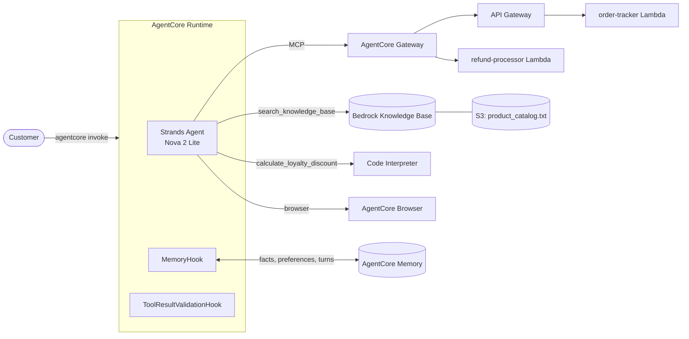

# Customer Support AI Agent on Amazon Bedrock AgentCore

An AI customer support agent for a fictional Amazon store, built with the [Strands Agents SDK](https://strandsagents.com) and deployed to **Amazon Bedrock AgentCore Runtime**. It tracks orders, processes refunds, answers policy questions from a knowledge base, calculates loyalty discounts in a secure sandbox, reads live websites, and remembers customers across sessions.

```text
Customer: I want to return my Kindle Paperwhite (ORD-002). Please initiate a refund.
Agent:    Your refund for the Kindle Paperwhite (ORD-002) has been approved!
          Refund ID: REF-BN3LRUAV · Amount: $139.99
          Credit will appear in your account within 3-5 business days.
```

---

## Features

| Capability | How it works |
|---|---|
| **Order tracking** | `order-tracker` Lambda behind API Gateway, exposed as MCP tools through an **AgentCore Gateway** |
| **Refunds and return labels** | `refund-processor` Lambda attached to the same Gateway as a direct Lambda target |
| **Policy and product answers (RAG)** | `search_knowledge_base` tool → Bedrock Knowledge Base built from `product_catalog.txt` |
| **Exact loyalty discounts** | `calculate_loyalty_discount` runs generated Python in the **AgentCore Code Interpreter**, so the model never does the maths |
| **Live web browsing** | `AgentCoreBrowser`: a sandboxed Chrome driven by Playwright |
| **Long-term memory** | A `MemoryHook` recalls extracted customer facts and preferences from **AgentCore Memory** and saves every turn |
| **Session history and summarization** | Earlier turns of a session are reloaded from Memory; above a token budget, older turns are summarized instead of dropped |
| **Validated tool output** | Pydantic models check every Gateway tool result and the discount breakdown (including its arithmetic) before the model sees them |
| **Graceful degradation** | If the Gateway, Memory, Knowledge Base or Code Interpreter is unavailable, the agent keeps answering with what still works |

---

## Architecture



**One request, step by step:**

1. `invoke()` receives `{"prompt", "customer_id", "session_id"}`.
2. The session's earlier turns are reloaded from Memory (`get_last_k_turns`). If they exceed `HISTORY_TOKEN_BUDGET`, the oldest half is summarized.
3. `MemoryHook` looks up long-term facts and preferences for this customer and prepends them to the message as `Customer Context`.
4. The agent picks tools: Gateway tools (orders and refunds over MCP), the Knowledge Base, the Code Interpreter or the browser.
5. `ToolResultValidationHook` validates each Gateway result. Malformed data is withheld and replaced with "temporarily unavailable, don't guess".
6. After the answer, `MemoryHook` saves the turn. AgentCore extracts new facts from it in the background.

---

## Tech stack

- **Agent:** Strands Agents SDK, Amazon Nova 2 Lite (`global.amazon.nova-2-lite-v1:0`) on Amazon Bedrock
- **Hosting:** Amazon Bedrock AgentCore Runtime (deployed with the AgentCore Starter Toolkit)
- **Tools:** AgentCore Gateway (MCP), AWS Lambda, Amazon API Gateway, Bedrock Knowledge Bases, AgentCore Code Interpreter, AgentCore Browser
- **Memory:** AgentCore Memory (semantic and user-preference strategies, plus short-term events)
- **Validation:** Pydantic v2
- **Tooling:** Python 3.13, uv

---

## Repository layout

```text
.
├── README.md                     ← you are here
├── REFLECTION.md                 ← design decisions, challenges, production plans
├── docs/
│   └── udacity-project-instructions.md   ← original course brief
├── screenshots/                  ← test evidence from the deployed agent
├── scripts/
│   └── fix_zip_permissions.py    ← Windows-only deploy fix (see below)
└── starter/
    ├── main.py                   ← the agent
    ├── lambda/                   ← order-tracker, refund-processor, refund tool schema
    ├── product_catalog.txt       ← Knowledge Base source
    ├── setup_permissions.py      ← grants the runtime role access to KB, memory, browser
    ├── test_validation.py        ← offline demo of the validation layer
    ├── pyproject.toml, uv.lock   ← local dependencies
    └── requirements.txt          ← dependencies resolved for the Linux ARM64 runtime
```

---

## Reproduce it

Everything is created in **us-east-1**. Allow about 1–2 hours for the AWS setup.

### Prerequisites

- An AWS account that can create IAM roles, Lambda, API Gateway, S3, Bedrock Knowledge Bases and AgentCore resources
- **Amazon Nova 2 Lite** enabled under *Bedrock → Model access*
- Python 3.13+, [uv](https://docs.astral.sh/uv/), AWS CLI v2

```bash
git clone https://github.com/chhalma/bedrock-agentcore-support-agent.git
cd bedrock-agentcore-support-agent/starter
uv sync --python 3.13
aws configure --profile <your-profile>
export AWS_PROFILE=<your-profile>          # PowerShell: $env:AWS_PROFILE = "<your-profile>"
```

If your credentials are temporary (the access key starts with `ASIA`), also set `aws_session_token`. All three values must come from the same session.

### 1. Lambda functions

In the Lambda console, create two **Python 3.12** functions, each with a new role that has basic Lambda permissions:

| Function | Code |
|---|---|
| `order-tracker` | paste `starter/lambda/order_tracker.py` |
| `refund-processor` | paste `starter/lambda/refund_processor.py` |

Click **Deploy** after pasting. Until you do, the function still runs the "Hello from Lambda" sample.

### 2. API Gateway (for `order-tracker`)

Create a **REST API** with three `GET` methods, each a **Lambda proxy integration** to `order-tracker`:

| Resource | Operation name |
|---|---|
| `/orders/{order_id}` | `get_order` |
| `/customers/{customer_id}/orders` | `get_customer_orders` |
| `/customers/{customer_id}` | `get_customer` |

Deploy it to a stage named `prod`. Check: `https://<api-id>.execute-api.us-east-1.amazonaws.com/prod/orders/ORD-001` should return the order.

### 3. AgentCore Gateway

In *Bedrock → AgentCore → Gateways*, create `CustomerSupportGateway` with inbound auth **NONE** and the default service role. Then add two targets:

| Target name | Type | Configuration |
|---|---|---|
| `order-tracker` | API Gateway | your REST API, stage `prod`, the three GET methods |
| `refund-processor` | Lambda ARN | the `refund-processor` ARN, inline schema = contents of `starter/lambda/lambda_schema` |

The console rejects underscores in target names, so use hyphens. Tool names become `order-tracker___get_order` and so on. Copy the Gateway URL (ending in `/mcp`).

> The NONE authorizer means anyone with the URL can call these tools. It is acceptable for this mock-data demo only. Delete the Gateway when you are done.

### 4. Knowledge Base

1. Upload `starter/product_catalog.txt` to an S3 bucket.
2. In *Bedrock → AgentCore → Built-in tools → Knowledge Base*, choose **Create Managed Knowledge Base**: managed embeddings, a new service role, and the S3 file as the data source.
3. **Sync** it, then check it in the **Test** tab: *"What is the return policy for electronics?"* should mention a 15-day window.

### 5. AgentCore Memory

Create `CustomerSupportMemory` with two strategies, and wait for **ACTIVE**:

| Strategy | Name | Namespace |
|---|---|---|
| Semantic | `customer_facts` | `cs_agent/{actorId}/facts` |
| User preference | `customer_preferences` | `cs_agent/{actorId}/preferences` |

### 6. Configure the agent

Edit the configuration block at the top of `starter/main.py`. Keep the values as literal strings, because `setup_permissions.py` reads them from the file:

```python
GATEWAY_URL = "https://<your-gateway>.gateway.bedrock-agentcore.us-east-1.amazonaws.com/mcp"
KB_ID       = "<your-kb-id>"
REGION      = "us-east-1"
MEMORY_ID   = "<your-memory-id>"
```

### 7. Run locally

From `starter/`:

```bash
uv run python -c "import asyncio, main; print(asyncio.run(main.invoke({'prompt': 'Can you track order ORD-001?', 'customer_id': 'CUST-123', 'session_id': 'local-1'})))"
uv run test_validation.py     # offline: shows good data passing and bad data being withheld
```

### 8. Deploy to AgentCore Runtime

```bash
uv run agentcore configure --entrypoint main.py --name customer_support_agent \
  --deployment-type direct_code_deploy --runtime PYTHON_3_13 --disable-memory
uv run agentcore deploy
uv run setup_permissions.py --profile <your-profile>
```

- Agent names allow only letters, numbers and underscores.
- At the configure prompts, press Enter to auto-create the execution role and S3 location, and answer **no** to OAuth.
- `--disable-memory` only stops the toolkit from creating a second memory; the agent uses the one from step 5.
- `setup_permissions.py` attaches a least-privilege policy for your KB, memory (including `ListEvents` for session history) and the browser. Wait about a minute for IAM to propagate.

To demo summarization with short conversations, deploy with a low budget: `uv run agentcore deploy --env HISTORY_TOKEN_BUDGET=500`. The default is 4000.

### Deploying from Windows

The toolkit builds a **Linux ARM64** package. On Windows, four extra steps are needed. (Deploying from WSL avoids all of them.)

1. **`zip` command:** the toolkit checks that `zip` exists. Install one (`winget install -e --id GnuWin32.Zip`) and add `C:\Program Files (x86)\GnuWin32\bin` to `PATH`.
2. **Linux dependencies:** the toolkit resolves `pyproject.toml` for the host OS, which pulls in the Windows-only `pywin32`. This repo ships a `requirements.txt` resolved for the target platform, and the toolkit prefers it. Regenerate it whenever dependencies change:
   ```powershell
   uv pip compile pyproject.toml --python-platform aarch64-manylinux_2_28 --python-version 3.13 --output-file requirements.txt
   ```
3. **Observability:** the OpenTelemetry launcher is packaged as a Windows `.exe`, so set `observability: enabled: false` in `starter/.bedrock_agentcore.yaml`.
4. **Executable permissions:** Windows zips have no Unix permission bits, so the browser fails with `Permission denied: .../playwright/driver/node`. After the first deploy, fix the cached package and deploy again:
   ```powershell
   python ..\scripts\fix_zip_permissions.py .bedrock_agentcore\<agent_name>\dependencies.zip
   uv run agentcore deploy     # should say "Using cached dependencies"
   ```

In PowerShell 5.1, escape the inner quotes of JSON payloads: `'{\"prompt\": \"Hello\"}'`.

---

## Try it

```bash
uv run agentcore invoke '{"prompt": "Can you track order ORD-001?", "customer_id": "CUST-123", "session_id": "t1"}'
```

| Scenario | Prompt | Expected |
|---|---|---|
| Order tracking | *Can you track order ORD-001?* | SHIPPED, UPS, `TRK987654321` |
| Refund | *I want to return my Kindle Paperwhite (ORD-002). Please initiate a refund.* | `REF-…` ID, APPROVED, 3–5 business days |
| Knowledge Base | *What are the benefits of the Platinum loyalty tier?* | free same-day shipping, 15% discount, priority support |
| Memory (two sessions) | A: *Hi, I am Jane. I prefer concise responses.* → wait 1–2 min → B (new `session_id`, same `customer_id`): *Do you remember my name and communication preference?* | recalls Jane and concise responses |
| Loyalty discount | *I am a Gold member with 4250 points. Calculate my discount on a $150 standard order.* | 4000 points redeemed, 10%, **$99.00**, 250 remaining (349 after earning) |
| Browser | *Go to https://www.udacity.com and tell me the page title.* | the live page title |
| Summarization | 5–6 turns with the same `session_id` | CloudWatch log `Summarized session history: 12 -> 7 messages` |

Mock customers: `CUST-123` (Jane, Gold, 4250 points; orders ORD-001 and ORD-002) and `CUST-456` (Bob, Silver, 890 points; order ORD-003). For a clean memory test, use a new `customer_id`.

Screenshots of every scenario on the deployed agent are in [`screenshots/`](screenshots/).

**Logs:**
```bash
aws logs tail /aws/bedrock-agentcore/runtimes/<runtime-id>-DEFAULT --since 30m
```

---

## Design notes

- **No maths in the model.** Discounts run as generated Python in the Code Interpreter, then a Pydantic model re-checks the arithmetic (blocks of 500 points, the 50% cap, the final total, the new balance). If the sandbox fails, a tier-only fallback still returns every field.
- **Validate before the model sees it.** A model repeats tool output confidently, so validation happens in an `AfterToolCallEvent` hook, *before* the result enters the conversation. Business errors such as "order not found" pass through; only malformed data is withheld.
- **Two kinds of memory.** Short-term memory (the session's raw turns, summarized when long) keeps a conversation coherent. Long-term memory (extracted facts and preferences) personalises across sessions. Injected context is stripped before saving, so memories don't feed back into themselves.
- **Fail soft.** Each dependency (Gateway, Memory, Knowledge Base, Code Interpreter) is wrapped, so an outage in one degrades that capability, not the whole agent. Internal error details are logged, never shown to the customer.
- **Least privilege.** The runtime role gets access to exactly one Knowledge Base, one Memory and the managed browser.

### Known limitations

- **The model can misreport correct tool output.** The discount tool's validated result is right ($11 tier discount, $99 total), but Nova 2 Lite occasionally recomputes 10% of the full order and reports $95. Next steps: have the tool return a ready-to-quote summary sentence, use a larger model, or check the final answer's numbers against the tool result before replying.
- **Unauthenticated Gateway.** Fine for mock data only; production needs JWT auth, with `customer_id` taken from the token.
- **Mock backends.** Orders and refunds are hard-coded in the Lambdas; nothing is persisted.

See [REFLECTION.md](REFLECTION.md) for the challenges encountered and production plans.

---

## Cleanup

Most resources are pay-per-use, but delete them when you are done:

1. `uv run agentcore destroy` (the runtime and its deploy artifacts)
2. *AgentCore → Gateways:* delete the Gateway (this closes the unauthenticated endpoint)
3. *AgentCore → Memory:* delete the memory
4. *Knowledge Bases:* delete the KB. Also check *OpenSearch Service → Serverless → Collections* for an auto-created collection, which is billed hourly.
5. *S3:* empty and delete the catalog bucket and the `bedrock-agentcore-codebuild-sources-<account>-<region>` bucket
6. *API Gateway:* delete the REST API
7. *Lambda:* delete `order-tracker` and `refund-processor`
8. *IAM (optional):* delete the roles created for the Lambdas, Gateway, KB and runtime

---

## Credits

Built as the *Customer Support AI Agent* project of Udacity's **Future AWS Agent Engineer Nanodegree**. The starter scaffolding, Lambda functions and catalog are Udacity course material (see [LICENSE.txt](LICENSE.txt)). The original brief is in [docs/udacity-project-instructions.md](docs/udacity-project-instructions.md).
